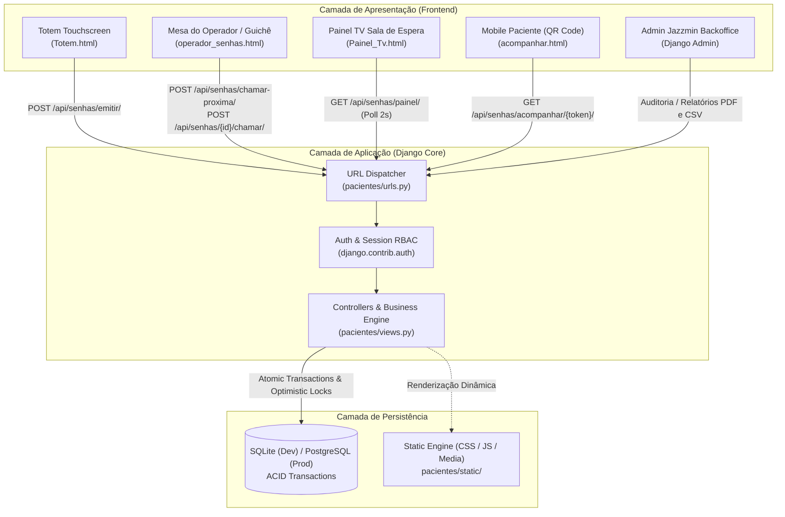
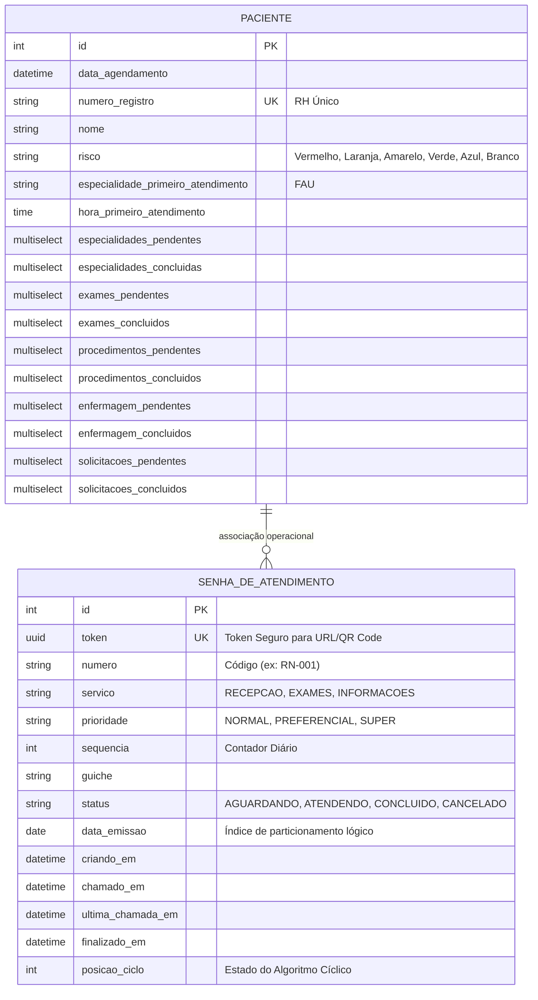

<div align="center">

# 🏥 Hospital Metropolitano

**Sistema Integrado de Gestão Hospitalar, Triagem Clínica e Chamada de Senhas em Tempo Real**

[](https://www.python.org/)
[](https://www.djangoproject.com/)
[](https://bun.sh/)
[](#-arquitetura-do-sistema)
[%20%7C%20PostgreSQL%20(Ready)-003B57?style=for-the-badge&logo=sqlite&logoColor=white)](https://www.sqlite.org/)
[-success?style=for-the-badge&logo=pytest&logoColor=white)](#-testes-e-garantia-de-qualidade)
[](#)

</div>

---

## 📋 Sumário Executivo

- [Visão Geral](#-visão-geral)
- [Arquitetura do Sistema](#-arquitetura-do-sistema)
  - [Fluxo de Dados e Componentes](#fluxo-de-dados-e-componentes)
  - [Modelo de Domínio (ERD)](#modelo-de-domínio-erd)
- [Módulos e Regras de Negócio](#-módulos-e-regras-de-negócio)
  - [1. Triagem e Fluxo Clínico (Manchester Protocol)](#1-triagem-e-fluxo-clínico-manchester-protocol)
  - [2. Motor de Senhas e Algoritmo Cíclico de Prioridades](#2-motor-de-senhas-e-algoritmo-cíclico-de-prioridades)
  - [3. Painel TV, Sinalização Sonora e Síntese de Voz (TTS)](#3-painel-tv-sinalização-sonora-e-síntese-de-voz-tts)
  - [4. Acompanhamento Mobile via QR Code](#4-acompanhamento-mobile-via-qr-code)
  - [5. Backoffice Administrativo, Auditoria e Relatórios](#5-backoffice-administrativo-auditoria-e-relatórios)
- [Especificação da API REST Interna](#-especificação-da-api-rest-interna)
- [Estrutura do Repositório](#-estrutura-do-repositório)
- [Instalação e Provisionamento Local](#-instalação-e-provisionamento-local)
- [Testes e Garantia de Qualidade](#-testes-e-garantia-de-qualidade)
- [Padrões de Concorrência, Segurança e Resiliência](#-padrões-de-concorrência-segurança-e-resiliência)
- [Diretrizes de Deploy e Produção](#-diretrizes-de-deploy-e-produção)
- [Padrões de Versionamento (Git Flow & Commits)](#-padrões-de-versionamento-git-flow--commits)
- [Governança e Licença](#-governança-e-licença)

---

## 📌 Visão Geral

O **Hospital Metropolitano** é uma plataforma corporativa desenvolvida para orquestrar o fluxo de pacientes em unidades de pronto atendimento, urgência e ambulatórios de alta demanda. A solução combina a gestão clínica de triagem com um motor transacional de chamadas e senhas distribuídas, mitigando gargalos operacionais e fornecendo transparência ao usuário final.

### Proposta de Valor e Pilares
* **Rastreabilidade Ponta a Ponta:** Desde o primeiro atendimento de urgência (FAU) até o encaminhamento a especialidades, procedimentos, exames e alta.
* **Equidade Operacional na Triagem de Filas:** Algoritmo cíclico balanceado que garante a conformidade com leis de prioridade sem desassistir a fila comum.
* **Experiência do Paciente Sem Barreiras:** Acompanhamento dinâmico da posição na fila via smartphone (QR Code no ticket térmico) sem necessidade de download de aplicativo.
* **Resiliência e Zero-Vendor Lock-in de Áudio:** Efeitos acústicos gerados por Web Audio API pura e chamadas em linguagem natural via Web Speech Synthesis nativa do navegador, operando sem dependências de serviços externos de nuvem.

---

## 🏗 Arquitetura do Sistema

A aplicação segue os preceitos de arquitetura orientada a serviços no modelo Django MTV (*Model-Template-View*), desacoplando a interface de sinalização e chamadores por meio de uma API REST interna baseada em JSON com persistência relacional ACID.

### Fluxo de Dados e Componentes



### Modelo de Domínio (ERD)



---

## ⚙️ Módulos e Regras de Negócio

### 1. Triagem e Fluxo Clínico (Manchester Protocol)
- **Classificação Visual por Gravidade:** Aplicação de regras cromáticas para rápida identificação na tela de triagem:
  - 🔴 **Vermelho:** Emergência (atendimento imediato).
  - 🟠 **Laranja:** Muito urgente.
  - 🟡 **Amarelo:** Urgente.
  - 🟢 **Verde:** Pouco urgente.
  - 🔵 **Azul:** Não urgente.
  - ⚪ **Branco:** Eletivo / Ambulatorial.
- **Auditoria de Pendências Médicas:** Indicadores booleanos em lote (`✔` e `✘`) gerados dinamicamente via `mark_safe` e `format_html` no painel administrativo, permitindo aos gestores de enfermagem acompanhar pendências de tomografias, SWAB, exames laboratoriais e SAE sem navegar entre telas.

### 2. Motor de Senhas e Algoritmo Cíclico de Prioridades
Para conciliar o cumprimento irrestrito das leis de prioridade (Lei Federal nº 10.048/2000 e Lei nº 13.466/2017) com a mitigação do abandono de fila comum, o sistema implementa um **Escalonador Cíclico Ponderado de 5 Posições**:

$$\text{Ciclo} = [\text{Superprioridade}, \text{Superprioridade}, \text{Preferencial}, \text{Preferencial}, \text{Comum}]$$

* **Comportamento Dinâmico:** Se a fila da categoria correspondente ao turno estiver vazia, o algoritmo avança imediatamente ao próximo tipo sem reter o guichê.
* **Identificadores Padronizados:** Códigos mnemônicos gerados no padrão `[Serviço][Prioridade]-[Sequência]` (ex: `RN-001` = Recepção Normal 001; `ES-003` = Exames Superprioridade 003).

### 3. Painel TV, Sinalização Sonora e Síntese de Voz (TTS)
- **Web Audio API Acústica:** O sinal de chamada (*chime* binaural de 523Hz/659Hz seguido de 392Hz/494Hz) é sintetizado em tempo de execução via nós de ganho exponencial do navegador, eliminando dependência de arquivos `.mp3` sujeitos a atraso de *buffering*.
- **Síntese de Voz Natural (TTS):** Processada via `SpeechSynthesisUtterance` com detecção de dialeto `pt-BR`, soletrando o código da senha e indicando o guichê de destino.
- **Autoplay Policy Bypass:** Implementação de barreira de ativação (*Audio Unlocker Modal*) para garantir conformidade com políticas rígidas de reprodução de mídia do Google Chrome e Safari.

### 4. Acompanhamento Mobile via QR Code
- Cada ticket térmico impresso no Totem gera um QR Code direcionando para a rota assinada `/acompanhar/<uuid:token>/`.
- O paciente monitora em tempo real a métrica de **pessoas na frente** calculada estritamente sobre a ordem de despacho.
- Quando a senha é chamada no operador, o dispositivo móvel ativa vibração tátil contínua (`navigator.vibrate`) e alerta sonoro direto no navegador do paciente.

### 5. Backoffice Administrativo, Auditoria e Relatórios
- Painel parametrizado com **Django Jazzmin** sobre Bootstrap Cosmo.
- Filtros por intervalo de datas baseados em `rangefilter.filters.DateRangeFilter`.
- Exportação instantânea de bases completas em **CSV estruturado** e emissão de prontuários / relatórios executivos em **PDF gráfico vetorial** utilizando `xhtml2pdf`.

---

## 📡 Especificação da API REST Interna

Todas as rotas de API operam com *payloads* em `application/json` e exigem o cabeçalho `X-CSRFToken` em operações mutativas (`POST`).

| Método | Endpoint | Nível de Acesso | Descrição | Status Codes |
| :---: | :--- | :---: | :--- | :---: |
| `POST` | `/api/senhas/emitir/` | Público | Emissão de ticket no totem | `201`, `400` |
| `GET` | `/api/senhas/painel/` | Público | Consulta de estado para TV (chamada atual + histórico) | `200` |
| `GET` | `/api/senhas/operador/?guiche={N}` | Autenticado | Estado da fila, métricas e senha ativa do guichê | `200`, `401` |
| `POST` | `/api/senhas/chamar-proxima/` | Autenticado | Despacho da próxima senha pelo ciclo ponderado | `200`, `400`, `404`, `409` |
| `POST` | `/api/senhas/{id}/chamar/` | Autenticado | Chamada direta ou rechamada de senha específica | `200`, `400`, `404`, `409` |
| `POST` | `/api/senhas/encerrar/` | Autenticado | Limpeza de expediente (cancela fila pendente e encerra ativas) | `200`, `401` |
| `GET` | `/api/senhas/acompanhar/{token}/` | Público | Consulta de status e contagem de fila para o mobile | `200`, `404` |

#### Exemplo de Requisição: Emissão de Senha
```bash
curl -X POST http://127.0.0.1:8000/api/senhas/emitir/ \
  -H "Content-Type: application/json" \
  -H "X-CSRFToken: <CSRF_TOKEN>" \
  -d '{"servico": "RECEPCAO", "prioridade": "PREFERENCIAL"}'
```

#### Exemplo de Resposta:
```json
{
  "id": 142,
  "token": "d8e3b219-58b2-4d2c-9a4f-a42e00e82c11",
  "codigo": "RP-012",
  "servico": "RECEPCAO",
  "servico_label": "Recepção e Cadastro",
  "prioridade": "PREFERENCIAL",
  "prioridade_label": "Preferencial",
  "status": "AGUARDANDO",
  "guiche": "",
  "criado_em": "14:22",
  "chamado_em": null,
  "chamada_ts": null,
  "url_acompanhar": "http://127.0.0.1:8000/acompanhar/d8e3b219-58b2-4d2c-9a4f-a42e00e82c11/"
}
```

---

## 📂 Estrutura do Repositório

```text
Metropolitano/
├── core/                                   # Kernel do projeto Django
│   ├── __init__.py
│   ├── asgi.py                             # Ponto de entrada ASGI (pronto para Channels/WebSockets)
│   ├── settings.py                         # Definições globais, middlewares, auth e Jazzmin
│   ├── urls.py                             # Roteamento raiz
│   └── wsgi.py                             # Interface WSGI para servidores de produção
├── pacientes/                              # Aplicação nuclear de domínio hospitalar
│   ├── admin.py                            # Customizações do Jazzmin, filtros e exportadores (PDF/CSV)
│   ├── apps.py
│   ├── models.py                           # Entidades Paciente e Senha_de_atendimento
│   ├── views.py                            # Controladores de tela e endpoints REST transacionais
│   ├── urls.py                             # Mapeamento REST e rotas de templates
│   ├── tests.py                            # Bateria de testes automatizados unitários e de integração
│   ├── migrations/                         # Histórico de migrações relacionais versionadas
│   │   ├── 0001_initial.py
│   │   └── 0010_painel_de_senhas.py
│   ├── static/pacientes/                   # Recursos estáticos servidos pelo Django Staticfiles
│   │   ├── css/                            # CSS legado e tema do admin
│   │   ├── img/                            # Assets institucionais (logos, backgrounds)
│   │   └── senhas/                         # Design system isolado do motor de senhas
│   │       ├── css/                        # base.css, totem.css, painel_tv.css, operador.css
│   │       └── js/                         # senhas.js (SDK/HTTP), totem.js, painel_tv.js, operador.js
│   └── templates/pacientes/                # Camada de apresentação do aplicativo
│       ├── BemVindo.html                   # Portal institucional do paciente
│       ├── Painel_Tv.html                  # Exibição contínua para Smart TVs e monitores
│       ├── Totem.html                      # Interface de emissão autoatendimento
│       ├── operador_senhas.html            # Console de controle do atendente / guichê
│       ├── acompanhar.html                 # PWA/Web responsivo de fila para smartphone
│       ├── index.html                      # Portal central de atalhos e monitoramento
│       └── pdf_pacientes.html              # Template vetorizado para renderização via xhtml2pdf
├── templates/                              # Sobrescrita de templates globais do Django
│   ├── admin/login.html
│   └── registration/base.html
├── package.json                            # Manifest e automação de scripts (Bun Task Runner)
├── requirements.txt                        # Manifesto determinístico de dependências Python
├── .gitignore                              # Diretivas de exclusão estrita para Git
└── manage.py                               # CLI administrativo do framework
```

---

## 💻 Instalação e Provisionamento Local

### Pré-requisitos
- **Git** $\ge$ 2.40
- **Python** $\ge$ 3.11 (Compatível e validado com Python 3.12 e 3.14)
- **pip** $\ge$ 23.0
- **Bun** $\ge$ 1.0 *(Recomendado para execução ágil com comando único)*

---

### ⚡ Execução Rápida via Bun (Recomendado)

O projeto conta com automação via `package.json`, permitindo executar o servidor e rotinas de manutenção com um único comando, **sem necessidade de ativar manualmente o ambiente virtual**:

```bash
# Iniciar o servidor de desenvolvimento diretamente
bun dev
```

#### 📋 Catálogo de Comandos Bun

| Comando | Equivalente Django | Finalidade |
| :--- | :--- | :--- |
| `bun dev` *(ou `bun run dev`)* | `./venv/bin/python manage.py runserver` | Inicia o servidor HTTP local na porta 8000 |
| `bun run migrate` | `./venv/bin/python manage.py migrate` | Aplica migrações pendentes no banco relacional |
| `bun run makemigrations` | `./venv/bin/python manage.py makemigrations` | Gera novos arquivos de migração a partir dos models |
| `bun run check` | `./venv/bin/python manage.py check` | Executa diagnóstico de integridade do sistema |
| `bun run test` | `./venv/bin/python manage.py test` | Executa a bateria de testes automatizados |
| `bun run shell` | `./venv/bin/python manage.py shell` | Inicializa o shell interativo do Django |

---

### 🐍 Guia de Inicialização Tradicional (Python CLI)

Caso prefira o fluxo nativo padrão do ecossistema Python:

1. **Clonagem e navegação:**
   ```bash
   git clone <URL_DO_REPOSITORIO>
   cd Metropolitano
   ```

2. **Criação e ativação do ambiente isolado (virtualenv):**
   ```bash
   # Linux / macOS
   python3 -m venv venv
   source venv/bin/activate

   # Windows (PowerShell)
   python -m venv venv
   .\venv\Scripts\Activate.ps1

   # Windows (CMD)
   .\venv\Scripts\activate.bat
   ```

3. **Instalação das dependências do projeto:**
   ```bash
   pip install --upgrade pip
   pip install -r requirements.txt
   ```

4. **Execução das migrações do banco de dados:**
   ```bash
   python manage.py migrate
   ```

5. **Provisionamento de credenciais administrativas:**
   ```bash
   python manage.py createsuperuser
   ```

6. **Inicialização do servidor de desenvolvimento:**
   ```bash
   python manage.py runserver 0.0.0.0:8000
   ```

Acesse o portal principal em: `http://127.0.0.1:8000/senhas/`.

---

## 🧪 Testes e Garantia de Qualidade

A integridade do domínio de atendimento é afiançada por uma suíte de testes unitários e de integração localizada em [pacientes/tests.py](file:///home/defensoria/Documents/Metropolitano/pacientes/tests.py).

### Cobertura de Testes
* `test_emitir_senha_api`: Validação de incremento estrito da sequência numérica diária por serviço e prioridade.
* `test_chamar_proxima_ciclo_prioridade`: Verificação da alternância justa $S \to S \to P \to P \to C$ sem inversão de fila.
* `test_estado_painel_tv`: Validação da serialização e coerência entre a senha atual e a lista de últimas chamadas.
* `test_acompanhar_senha_celular`: Cálculo da posição ordinal de espera de pacientes na fila.
* `test_render_views`: Checagem de integridade de código HTTP 200 em todas as rotas públicas e autenticadas.

### Como Executar

**Via Bun (rápido):**
```bash
bun run test
```

**Via Python nativo:**
```bash
python manage.py test pacientes -v 2
```

Saída esperada:
```text
System check identified no issues (0 silenced).
.....
----------------------------------------------------------------------
Ran 5 tests in 2.728s

OK
```

---

## 🔒 Padrões de Concorrência, Segurança e Resiliência

* **Prevenção de Race Conditions:** Em ambientes de múltiplos guichês operando simultaneamente, a chamada de senha utiliza *atomic updates* condicionais:
  ```python
  # pacientes/views.py
  with transaction.atomic():
      if not Senha.objects.filter(pk=senha.pk, status='AGUARDANDO').update(
          status='ATENDENDO', guiche=guiche, chamado_em=agora, ultima_chamada_em=agora
      ):
          return False  # Notifica conflito caso outro guichê tenha despachado milissegundos antes
  ```
* **Imutabilidade e Segurança de Tickets:** Cada senha possui um `uuid.uuid4` gerado no ato de emissão. URLs de acompanhamento móvel não expõem IDs sequenciais, impedindo enumeração forçada (*IDOR protection*).
* **Controle de Acesso Baseado em Sessão (RBAC):** Rotas operacionais e administrativas exigem autenticação via `@login_required` com redirecionamento automático para a interface autenticadora.
* **Isolamento de Base de Dados:** O arquivo `db.sqlite3` é excluído do controle de versão pelo `.gitignore`, prevenindo contaminação de dados locais em repositórios remotos.

---

## 🚀 Diretrizes de Deploy e Produção

Para implantação em ambiente corporativo ou nuvem (AWS, GCP, DigitalOcean, On-Premises), siga os parâmetros recomendados de engenharia:

1. **Engine de Banco de Dados:** Substituir o SQLite por **PostgreSQL $\ge$ 15** ajustando `DATABASES` no `settings.py` (ou utilizando variáveis de ambiente via `dj-database-url`).
2. **Servidor de Aplicação:** Executar o projeto atrás de **Gunicorn** (WSGI) ou **Daphne/Uvicorn** (ASGI):
   ```bash
   gunicorn core.wsgi:application --bind 0.0.0.0:8000 --workers 4 --threads 2
   ```
3. **Servidor Web Reverso e SSL:** Utilizar **Nginx** como *reverse proxy* para terminação SSL/TLS (HTTPS) e entrega de arquivos estáticos coletados (`python manage.py collectstatic`).
4. **Variáveis de Ambiente:** Externalizar `SECRET_KEY`, `DEBUG=False` e `ALLOWED_HOSTS` através de arquivos `.env` ou *secrets manager*.

---

## 📐 Padrões de Versionamento (Git Flow & Commits)

O projeto adota a convenção internacional de **[Conventional Commits](https://www.conventionalcommits.org/pt-br/)**:

| Prefixo | Finalidade | Exemplo |
| :--- | :--- | :--- |
| `feat:` | Nova funcionalidade de negócio | `feat: implementar telemetria de audio com web audio api` |
| `fix:` | Resolução de bug ou correção de comportamento | `fix: corrigir race condition no despacho concorrente de senhas` |
| `docs:` | Atualização em documentação técnica | `docs: reestruturar arquitetura executiva no readme` |
| `test:` | Implementação ou ajuste em baterias de testes | `test: cobrir calculo de pessoas na frente no mobile tracking` |
| `refactor:` | Refatoração de código sem impacto na regra funcional | `refactor: desacoplar engine de polling do operador.js` |
| `chore:` | Alterações em build, dependências ou .gitignore | `chore: atualizar requisitos de producao no requirements.txt` |

---

## 👥 Governança e Licença

Desenvolvido para modernização e automação dos fluxos ambulatoriais e de triagem do **Hospital Metropolitano**.

Todos os direitos reservados à instituição gestora. Uso e distribuição regidos pelas diretrizes corporativas internas.
